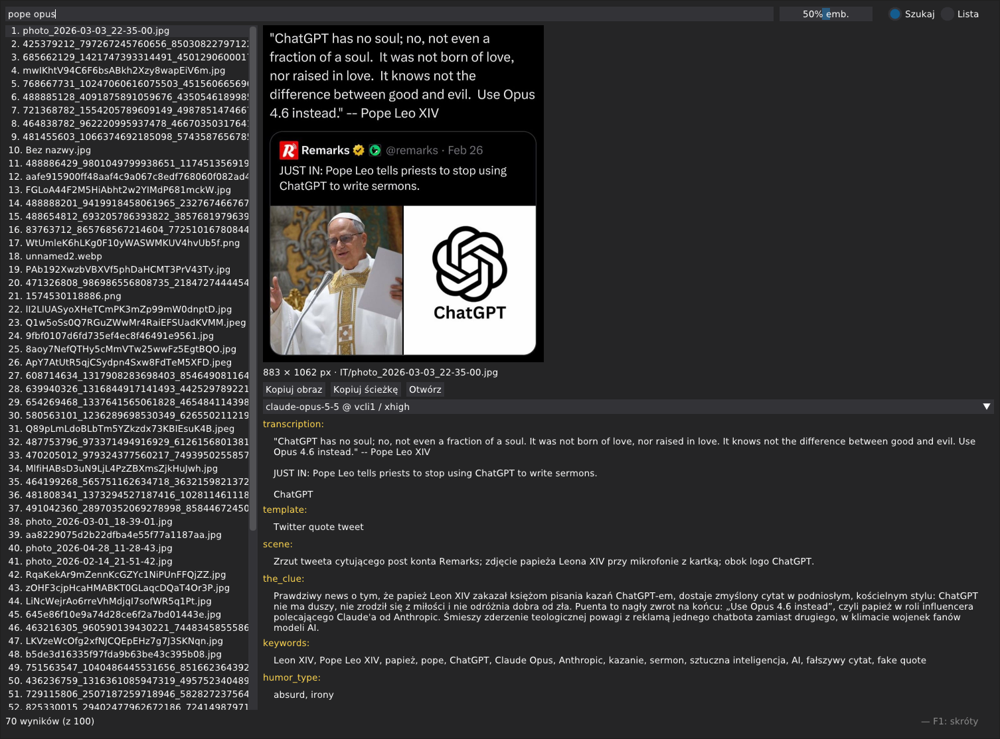

# Meme Semantic Search

### WIP

Find a meme in your own collection by describing what you remember: the scene,
the punchline, a quote, or a situation where you would use it. Queries can be in
Polish or English, even when the text in the meme is in the other language.
Results point to your original image files; the desktop GUI adds previews,
collection browsing and duplicate management.



## How it works

The project searches text descriptions of memes. At indexing time, a vision
model reads each image and records its visible text, scene, recognizable template,
keywords and an explanation of the joke. That explanation matters: “wordplay on
a dead dad” describes how a meme works, which is hard to recover from visual
similarity alone.

Descriptions are then converted into embeddings: numerical representations used
to compare their meaning with your query. Search combines this semantic matching
with full-text search (FTS), which helps with quotes, names and exact words.
There is no vision-model call for each search.

1. **Descriptions can use a remote model.** Choose an OpenAI-compatible HTTP
   service or an authenticated Claude Code, Codex or OpenCode CLI. A local vision
   model through Ollama is also supported, but is optional. A CLI running on your
   computer can still send images to a remote service; billing and usage limits
   follow its provider and login method.
2. **Embeddings and search stay local.** The intended setup uses Ollama with
   multilingual `bge-m3` to embed both saved descriptions and search queries.
   Metadata, saved descriptions and search indexes live in a local SQLite file.
   After indexing, searching needs the local embedding service, without another
   call to the description provider.
3. **Expensive work is saved.** Describing a large collection can take hours and
   cost money with a paid provider. Completed descriptions are kept, so a later
   embedding run can reuse them without sending the images again. Normal repeat
   runs skip completed work and fill gaps.
4. **Duplicates share work.** Identical files share descriptions and an index.
   Visually similar images are grouped, and only one representative per group
   is described and included in search. You can still browse all scanned files
   in the GUI. Similarity grouping is approximate and can group different memes.

Search quality depends on the description: if the vision model misreads a quote
or misses the joke, semantic search can miss it too. Animated images are described
using selected frames, so not every moment of an animation is examined.

## Getting started

Run commands from the project directory. You need Python 3.12+, `uv`, and Ollama
for local embeddings. Install `ffmpeg` on `PATH` to describe animated
GIF/WebP/APNG files. CLI description backends additionally need their respective
client installed and logged in.

```sh
uv sync --locked
ollama pull bge-m3
cp config.example.toml config.toml
```

Make sure Ollama is running. Edit `config.toml` before indexing:

1. Set `image_dir` to the folder containing your memes. Subdirectories are
   scanned too.
2. Optionally set `exclude_paths` to files or directories relative to `image_dir`:

   ```toml
   image_dir = "/path/to/memes"
   exclude_paths = ["private", "drafts/unused.png"]
   ```

   A directory entry excludes everything beneath it. Absolute paths and `..`
   are rejected. The next scan removes excluded paths from `meme_files`. If no
   copy remains, its descriptions are kept for a future reappearance, while its
   search indexes are removed. Archived rows in `memes` retain their hash and
   description but have an empty `path`.
3. Set `db_path` to the SQLite file where the collection and its indexes will
   be stored. It is created on the first scan.
4. Configure `[describe]` using one of the options below. The example file
   defaults to a local `qwen3-vl:8b`; that model is only needed if you keep the
   local description setup (`ollama pull qwen3-vl:8b`).
5. Keep `[embed]` pointing at local Ollama:

```toml
[embed]
base_url = "http://localhost:11434/v1"
api_key = "ollama"
model = "bge-m3"
```

Keep the database as well as your images when backing up the collection: it
contains the descriptions you have already generated. Configuration files can
contain provider credentials; keep those private.

### Choosing a description backend

`[describe]` is independent of `[embed]`. Changing the description provider
does not require moving embeddings or search to that provider.

For an **OpenAI-compatible HTTP service**, set its URL, credentials and a
vision-capable model in `[describe]`. The service must support structured JSON
output using `response_format: json_schema`.

```toml
[describe]
backend = "openai"
base_url = "https://your-provider.example/v1"
api_key = "YOUR_API_KEY"
model = "YOUR_VISION_MODEL"
prompt_version = "vcodex1-master"
```

Replace the placeholder URL, key and model with your provider's values. Add
`effort_level` only if the model supports it. For local Ollama descriptions, use
the connection and model from `config.example.toml` instead.

For a **CLI backend**, select the client and a vision-capable model available
through your account. For example, a Codex description section is:

```toml
[describe]
backend = "codex-cli"
model = "YOUR_VISION_MODEL"
prompt_version = "vcodex1-master"
# effort_level = "low" # optional; depends on the model
```

| Backend | What to configure |
|---|---|
| `claude-code-cli` | A model available through your logged-in `claude` client. |
| `codex-cli` | A model available through your logged-in `codex` client. Optional `codex_profile` imports provider connection settings and model/effort defaults from a profile file; see `config.deepseek.toml`. |
| `opencode-cli` | OpenCode V2 and a model in `provider/model` form. Optional `effort_level` selects a variant; do not also put a variant in `model`. |

CLI backends use their own authentication; `[describe].base_url` and `api_key`
are unused. The adapters restrict model tools and send the prepared images and
description instructions. Check one image before starting a full collection:

```sh
uv run memes.py scan
uv run memes.py describe --limit 1
uv run memes.py embed --limit 1
uv run memes.py gui
```

`scan` scans the entire folder and groups duplicates. `--limit 1` applies only
to the selected `describe` or `embed` stage. Inspect the result in the GUI.
To print a description, run `uv run memes.py describe --limit 1 -v`;
already completed descriptions are skipped.

## Indexing and searching

Build or update the collection with:

```sh
uv run memes.py all
```

`all` runs `scan`, `describe`, and `embed` in that order. You can also run each
stage separately. `scan` finds files and groups duplicates; `describe` generates
missing descriptions; `embed` builds missing search indexes. Completed work is
saved incrementally, so an interrupted run can be resumed with the same command.
`all` accepts their flags: `--regroup-only` and `--prune-missing` affect scanning;
`--path`, `--undescribed-only`, `--any-effort`, `--effort`, and `-v` affect
describing. `--model` selects the model for describing and embedding, while
`--limit` caps describing and embedding separately. `--path` selects descriptions
to generate; embedding still processes all eligible descriptions.

Search from the terminal or open the GUI:

```sh
uv run memes.py search "mem z poszerzaniem paska"
uv run memes.py search "harry potter" --show
uv run memes.py gui
```

CLI search prints one matching path per line. `-n` / `--top` changes the number
of results. `--show` opens them in an installed viewer (`imv`, `feh`, `nsxiv` or
`loupe`). Try describing the punchline or intended reaction when a literal scene
description does not find the meme.

Every command accepts `--config FILE` after its name; the default is
`config.toml`. For example:

```sh
uv run memes.py all --config config.test.toml --limit 1
uv run memes.py describe --config config.test.toml --limit 1
uv run memes.py search --config config.test.toml "widening the belt"
```

## Using the desktop GUI

1. **Szukaj** searches as you type and previews the selected result. The
   **FTS / Embeddingi** slider balances exact words against semantic similarity;
   it starts with equal weights. Fully left uses only full-text search and does
   not need the embedding service. Fully right uses only embeddings.
2. **Lista** browses all scanned physical files, including those without a
   description or embedding. Its text field filters filenames and paths locally.
   Filters include **Wszystkie**, **Duplikaty**, **Identyczne kopie**,
   **Nieopisane** and **Błędy**. Description states refer to the active
   model/prompt/effort settings; the separate “w indeksie” marker indicates an
   existing search vector, possibly from another description variant.
3. **Preview and descriptions.** Select a file to view it and inspect its saved
   description variants. You can copy the image or its path and open it in an
   external viewer. F1 shows keyboard shortcuts. Switching between Szukaj and
   Lista preserves their queries and selections.
4. **Duplicates.** Use **Grupa duplikatów** for visually similar images or
   **Identyczne kopie** for files with identical contents. Selecting a path
   previews that physical file; copying and opening then use that copy.
   **Wróć do wyniku** returns to the result, and Esc closes the duplicate list.
5. **Embeduj opisane** in Lista fills missing search indexes in the background
   for the whole collection, regardless of filters or checked files. It uses
   each representative's newest successful description across all models,
   prompts and effort levels. Existing vectors are skipped. Progress and failures
   are shown; clicking again retries missing embeddings.
6. **Deleting files.** Select checkboxes in Lista and use **Usuń zaznaczone
   pliki**, or right-click a file for **Usuń plik** / **Usuń resztę z grupy**.
   The latter keeps the clicked file. Deletion is permanent and requires
   confirmation. The application checks file contents immediately before
   deleting; replaced files and filesystem failures are reported. Removing one
   identical copy preserves shared descriptions while another copy remains.
   Deletion is blocked during background embedding.

Scanning and describing are run from the CLI. Restart the GUI after a CLI scan
or indexing run to reload collection data. Background embedding from the GUI
refreshes its table and search results automatically. Browsing Lista and previews
works without Ollama; semantic search and embedding need it running.

## Updating and troubleshooting the collection

| Task | Command or setting |
|---|---|
| Discover files without calling models | `uv run memes.py scan` |
| Run scan, describe and embed in order | `uv run memes.py all` |
| Generate missing descriptions and print them | `uv run memes.py describe -v` |
| Retry recorded description failures | `uv run memes.py describe --retry-failed` |
| Describe only memes with no successful description under any settings | `uv run memes.py describe --undescribed-only` |
| Generate missing embeddings from saved descriptions | `uv run memes.py embed` |
| Retry descriptions and continue through embedding | `uv run memes.py all --retry-failed` |
| Recompute similarity groups from stored hashes | Change `phash_threshold`, then run `uv run memes.py scan --regroup-only` |
| Remove stale paths under `image_dir` | `uv run memes.py scan` |
| Also check stored paths outside `image_dir` | `uv run memes.py scan --prune-missing` |

`describe --undescribed-only` still needs `--retry-failed` for a failed attempt
under the active settings. `describe`, `embed`, and `all` accept `--limit N`; it
limits the description and embedding work in that run, not the scanned collection.

Descriptions are stored separately by model, `prompt_version` and
`effort_level`. Changing those settings normally adds another variant while
preserving earlier descriptions. `prompt_version` selects a file in `prompts/`.
`describe --any-effort` skips memes already described by the same model and
prompt at any effort level. `describe --path FILE...` explicitly re-describes
chosen scanned files and replaces their description for the active settings;
it bypasses normal queue and duplicate skipping and cannot be combined with
`--undescribed-only`.

CLI `embed` selects descriptions within the active prompt version, preferring
the configured model and effort, then the same model at another effort, then
another model. Its `--model` flag chooses whose descriptions to embed; the
embedding model itself is configured in `[embed]`. The GUI's **Embeduj opisane**
instead uses the newest successful description across all configurations.

**Changing description settings does not replace existing embeddings.** There
is one vector per meme; embedding runs fill missing entries. To rebuild search
from another description variant, back up the database, clear `memes_vec` and
`memes_fts`, then run `embed` with the chosen configuration. Saved descriptions
can be reused. Keep `bge-m3` for both indexing and queries: changing the embedding
model requires rebuilding the index, and the current schema expects 1024 dimensions.

Individual unreadable images, invalid descriptions and timeouts are recorded as
description failures; use `--retry-failed` after resolving the cause. Codex and
OpenCode process, authentication or quota errors stop the run without recording
a description for the current image, so a normal rerun resumes it. Claude's
recognized usage-limit errors wait and retry automatically. Some free OpenCode
gateways can reject the adapter's restricted tool setup even when the model
works in a normal client session.

If a similar image seems missing from search, check its duplicate group in Lista.
Groups can contain false positives; lower `phash_threshold` and regroup to make
matching stricter. Scanning and grouping do not delete image files.

For development details, see [AGENTS.md](AGENTS.md), the
[manual verification guide](TESTING.md), and
[architecture notes](ARCHITECTURE.md). The architecture document includes
historical assumptions; use the current configuration and code for exact behavior.
